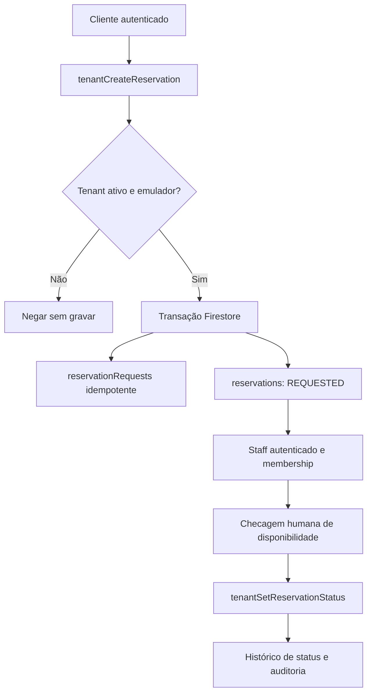

# Reservas do núcleo Multi-Tenant (F4)

Estado: **EMULATOR_ONLY — NOT_PRODUCTION_READY**. Não reimplementar o código de reservas legado da Teiko.

## Fontes implementadas

- `functions/src/tenant-reservations.ts`: seis Callables com `tenantId` no caminho Firestore.
- `functions/src/resolve-tenant.ts`: `reservationsEnabled` retorna verdadeiro somente em Auth+Firestore Emulator para tenant ativo com flag explícita.
- `app/loja/[slug]/reservas/page.tsx`: solicitação; `reservas/[reservationId]`: status privado; `reservas/gestao`: console staff.
- `tests/firestore.rules.test.ts` e `functions/src/create-order.e2e.test.ts`: isolamento A/B, estado suspenso, transições inválidas, revogação e privacidade.

## Fluxo de dados

## Escopo e limites

- Solicitação não constitui confirmação. O servidor não conhece duração de ocupação, mapa de mesas ou disponibilidade de assentos.
- Não há prazo nem capacidade inventada; devem vir de configuração real e da comercialização Pro/Premium aprovada.
- `REQUESTED -> CONFIRMED|REFUSED|CANCELLED`; `CONFIRMED -> COMPLETED|CANCELLED`; estados finais não reabrem.
- Os dados pessoais de contato só podem ser lidos por staff autorizado; documentos diretos não são graváveis pelo cliente.
- Produção continua fechada até F5 EntitlementService, testes de capacidade, UAT e autorização explícita.

- Histórico limitado a 20 registros por UID/tenant via `tenantListMyReservations`; UI em `/loja/[slug]/reservas/historico`, sem consulta por telefone.
